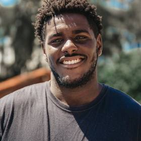

# Personas, scenarios and storyboard outline (T14)

Status: **v2, 14 Nov 2026.** Owners: KAYZ (personas, scenarios), Jishnu (storyboards). Product: **LockedIN**.
Clickable version: `../prototype/sketch/lockedin-sketch.html`, under the Personas and Scenarios tabs.

Built from:
- `../research/questionnaire-results.md` (Q-n)
- `../research/affinity.md` (AFF-x)
- `../research/autoethnography-01-kobi.md` (AE-n) and `../research/autoethnography-02-kobi.md` (AE2-n)
- the six interviews in `../research/interviews/` (INT-0n-x)
- the phone literature in `../research/literature-phones.md` (LIT-n)

**The people are fictional.** Names, ages, homes and photos are invented to make them memorable. Every attribute that drives a design decision cites the data behind it, so a persona is never a stereotype we made up (Wk 3). Each persona follows Brown's anatomy (Wk 3): photo, identity, goals, behaviours, frustrations, attitudes, context of use, technology, quote and sources.

**What changed in v2:**
- Interview evidence added throughout.
- Each persona is filled out to the full Brown anatomy, with a stock photo.
- Context of use is added, covering where, when, with whom and how noisy, because the 6 interviews showed place matters (INT-03-d, INT-05-b, INT-06-c).
- A second anti-persona, Dev, the technical power user (10 Nov sync decision).
- Scenarios are rewritten. Each one is now a persona walking through the rough sketch in a different context.

## Why personas, and why four
Personas keep the team designing for the students in our data, not for ourselves ("you are not the user", Wk 1; and personas stop us designing for an "elastic user", Wk 3). We use the Week 3 types:
- a **primary** persona the design must satisfy;
- a **secondary** persona whose needs we meet without breaking the primary's;
- **anti-personas** we deliberately don't design for, which protect us from feature creep (rubric criterion 6).

We now have two anti-personas because two different users would pull the product off course in opposite directions. Sam wants LockedIN to do the work for him. Dev wants it to give him more control.

---

## Primary: Tayo Adeyemi, the student who can't get going

> "I know how to revise. I just don't feel like starting." *(composite of Q12 and INT-05-a)*

**Identity.** 21, third year, Mechanical Engineering. Lives in a shared house 15 minutes' walk from campus. Not sure if he's neurodivergent. (He matches the largest questionnaire groups: 3rd year+ 10/22, STEM 9/22, "not sure" 8/22.)

| Layer | Detail | Evidence |
|---|---|---|
| **Goals** | Keep up week by week, so exam season isn't a cram. Get the grade he needs for his placement year | AE-9, AFF-F, INT-01-a |
| **Behaviours** | Goes to most lectures. Studies by rereading slides and asking ChatGPT. Means to start after lectures but usually starts late in the evening, if at all. Goes to the library because being there commits him, even on days little gets done | Q4, Q-6, Q-1, INT-03-d, INT-05-b |
| **Frustrations** | Getting started, weekly or more. When nothing is due, days slip. Once he starts he's mostly fine, but breaks turn into 20 minutes of scrolling | Q-1, INT-05-a, INT-04-a, INT-03-b, AFF-A |
| **Attitudes** | Would welcome one short quiz in a free gap, but never repeated reminders. Turns notifications off once there are more than one or two a day. Will plan in weeks, but needs to move a block when his week changes. Fine sharing his timetable, not his location | Q-8, Q-9, INT-05-g, INT-05-h, Q-10 |
| **Context of use** | Two-hour gaps between lectures, spent in the student hub, which is loud and full of friends. Evenings at a bedroom desk with the phone beside him. The library works when he gets there | INT-03-d, INT-05-b, INT-06-c, LIT-6 |
| **Technology** | iPhone, laptop, Canvas, ChatGPT. Comfortable with apps. Will not configure anything that takes longer than a minute | Q-6, AE2-1 |
| **A typical week** | Mon to Thu lectures and labs; Friday free; weekend shifts at a part-time job. Most free gaps go unused | Q4, Q-1 |

**What Tayo needs from LockedIN:**
- Weekly study blocks he can move (INT-05-h).
- One well-timed nudge (Q-8, Q-9).
- A first screen that shows the tiniest first step (INT-04-e), so starting costs almost nothing (AFF-A).
- A prompt to move somewhere quieter when he's about to start in the hub (INT-05-b).

## Secondary: Maya Rao, the student who drifts and needs a way in

> "Even just the very, very first, tiniest step." *(INT-04-e)*

**Identity.** 20, second year, Psychology. Shares a house with four flatmates. Identifies as neurodivergent. (Q3: 4 yes, 8 not sure.)

| Layer | Detail | Evidence |
|---|---|---|
| **Goals** | Stop falling behind on the lectures she skipped | Q4 (7/22 attended no lectures) |
| **Behaviours** | Missed most lectures in the past fortnight. Doesn't watch recordings. Her phone is always next to her and almost always pulls her away. Studying with friends turns social | Q-5, INT-04-b, INT-06-c, AFF-B |
| **Frustrations** | Attention drifts within ten minutes. Breaking a task down is the hardest part. Hard material makes her quit and come back days later | Q-4, INT-04-e, Q12, AFF-C |
| **Attitudes** | Wants to be shown first in some subjects and asked questions in others. Would use a phone lock for urgent work but switch it off otherwise. A fixed timer that cuts her off mid-task makes her drop the task | Q-7, INT-04-h, INT-04-g, INT-03-c |
| **Context of use** | Studies in bed or at the kitchen table while flatmates come and go. Wears headphones to block noise, and then scrolls with them on. Sometimes goes to a café with a friend, which becomes a chat | INT-06-c, AFF-B, LIT-7 |
| **Technology** | Android phone, TikTok, a notebook-style AI quiz app. Trusts AI summaries more than Tayo does | INT-06-e, INT-03-f |
| **A typical week** | Lectures she means to attend, a café job two evenings a week, and late nights | Q4 |

**What Maya needs:**
- Very short sessions that survive interruption.
- A "show me first" mode.
- A lock whose strictness she chooses and can end, with breaks that wait until she finishes the question she's on (INT-04-g, INT-03-c, LIT-10).
- A nudge away from the bed and the kitchen table that never feels like a telling-off.

She is secondary because meeting her needs doesn't harm Tayo's experience.

## Anti-persona 1: Sam Novak, who wants the work done for him

> "Can't it just give me the answers?"

**Identity.** 19, first year, Business. Always on his phone between places.

| | |
|---|---|
| **What he wants** | An app that writes the answers and summaries so he doesn't have to. |
| **Why he's out of scope** | Learning sticks when the student produces the answer (AFF-D, Q-6, AE-4). An app that hands over answers is what students already use most and trust least: AI chatbots are used by 15/22 and rated best by 2/22. Two interviewees distrust AI as a source of truth (INT-01-g, INT-02-i). |
| **What we refuse because of him** | Generating answers on request, writing essays or summaries, and "skip to the answer" before an attempt. "Show me first" shows a worked example of a *similar* question, then asks him to do his own. |

## Anti-persona 2: Dev Walsh, the technical power user

> "Where do I pick the model?"

**Identity.** 23, final-year Computer Science. Builds his own study setup and enjoys configuring it. He looks a lot like the people building LockedIN.

| | |
|---|---|
| **Who he is** | Happy to clone a repo, install a CLI, pick a model, upload his own material and tune every setting before learning anything. He would enjoy LearnHarness exactly as it ships. |
| **Why he's out of scope** | Designing for Dev produces the setup that lost our own autoethnographer: six steps before the first question in LearnHarness (AE2-1), and an onboarding that felt four times its real length (AE2-P14, AE2-P15). Our primary user's problem is the cost of starting (Q-1, AFF-A), and every option Dev wants raises that cost. The 10 Nov sync named him as the anti-persona: "technical power users like us". |
| **What we refuse because of him** | Any setup before the first useful moment. Model choice, CLI steps and "bring your own material" in the main flow. Settings-first onboarding. Advanced options stay behind one settings screen, out of the start flow. |
| **The trap he sets** | He's the easiest user for us to test on, because he's us. Lo-fi and hi-fi testers (T18, T23) must come from students who aren't on technical courses. |

Photo credits (Unsplash Licence, free to use): Tayo, Elizeu Dias; Maya, Chidera Faustina Okeke; Sam, Anton Ryazanov; Dev, Vitaly Gariev.

---

## Scenarios: each persona walks through the sketch in a different context
Grudin and Pruitt (Wk 3): personas first, then scenarios that act them out. The screen numbers refer to the sketch.

**S-1 Tayo, Tuesday 13:05, the student hub (post-lecture nudge).** HCI ended at 13:00. His timetable is empty until 15:00. He's in the hub with friends, and it's loud.
1. One notification arrives: "10 minutes on this morning's lecture? First step: answer one question." **(4 Nudge)**
2. He opens it. The block screen asks where he is. He taps "Café / hub", and LockedIN suggests the library's quiet floor, 4 minutes away, or headphones and a corner. He walks over. **(5 Block start)**
3. He picks Quiet. The first question is on screen before he can think about it. He gets question 3 wrong, gets a one-line hint, and gets it right on the second try. **(6 Session)**
4. He's done in 9 minutes. His apps are back before the summary shows, and question 3 is booked for Friday's review. **(8 Done)**

*Evidence: Q-1, Q-8, Q-9, Q-10, INT-05-b, INT-05-g, INT-03-d, AFF-A, AFF-D, AFF-E. Syllabus: context awareness and environmental requirements (Wk 1), the O'Kane environment theme (Wk 3), post-completion error (Wk 4).*

**S-2 Maya, Wednesday 21:30, in bed (show me first, then interrupted).** Nothing is due. Her flatmates are loud in the kitchen.
1. She opens LockedIN herself. It suggests the lecture she missed, as three 5-minute chunks. **(5 Block start)**
2. She taps "Bed". LockedIN says starting is easier sitting up at a desk, and suggests putting the phone across the room with only LockedIN allowed through. She moves to her desk and picks Off: she doesn't want a lock tonight. **(5 Block start)**
3. Two questions in, she taps "show me first". She gets a worked example of a similar question, with the slide it came from, then a question of her own. **(6 Session)**
4. A friend messages her and she leaves. An hour later she opens the app, and it resumes at the same question, with no penalty. **(8 Done)**

*Evidence: Q-4, Q-7, INT-01-g, INT-01-i, INT-04-h, INT-04-g, AFF-B, AFF-C, LIT-6. Syllabus: forgiving design for memorability and safety (Wk 1), recognition over recall (Wk 4).*

**S-3 Tayo, Sunday on the sofa, then Thursday in the library (the weekly block).**
1. On Sunday he sees two suggested blocks. He moves Thursday's because of a lab, and the moved block is outlined and labelled so he notices the change. **(3 Week)**
2. On Thursday at 14:00 the block opens. He taps "Library", and the app skips the environment prompt. Tiny first step: slide 1, one question. He picks Quiet. **(5 Block start)**
3. Forty minutes later the set ends and LockedIN offers a break. It's never mid-question. He takes 10 minutes. **(7 Break)**
4. He missed last week's block. There's no streak to lose, and it picks up where he left off. **(8 Done)**

*Evidence: Q-1, Q-10, INT-05-h, INT-04-e, INT-04-g, INT-03-c, INT-01-i, LIT-3, LIT-10, LIT-12. Syllabus: change blindness (Wk 4), implementation intentions (T20).*

**S-4 Maya, Monday 17:40, on the bus home (first use).** A friend told her about LockedIN. She has 15 minutes and patchy signal.
1. Before any account, she answers one question from that morning's lecture. **(1 First taste)**
2. Three setup questions, all taps and nothing to type: timetable, energy time, strictness. Under a minute. **(2 Setup)**
3. Her week fills with two suggested blocks. **(3 Week)**

*Evidence: 10 Nov decision (value before onboarding), AE2-1, AE2-P14, AE2-P15, Q-10. Syllabus: learnability (Wk 1), chunking and recognition over recall (Wk 4).*

**Anti-scenario A-1 Sam, the night before a deadline.** He taps "show me first" hoping for the answer. He gets a worked example of a similar question and then has to answer his own. LockedIN never writes his answers. *(AFF-D, INT-01-g)*

**Anti-scenario A-2 Dev, first open.** He looks for the model picker during setup and doesn't find one. It's under Settings, then Advanced, out of the start flow. *(AE2-1, 10 Nov decision)*

## Storyboard outline (Jishnu to draw, Wk 3 structure; follows S-1)
1. **Establishing shot.** 13:00. Tayo leaves the lecture for the loud student hub.
2. **The trigger.** One notification with one tiny first step.
3. **The context check.** "Where are you?" He taps hub, sees the library suggestion and walks over.
4. **The choice.** He picks Quiet.
5. **The struggle.** A wrong answer gets a one-line hint, not the answer.
6. **Payoff.** Done in 9 minutes. His apps are back, and the missed question is booked for Friday.

## Limitations
- **Small, mixed interview sample.** n = 6, two interviewers, three of the participants postgraduates. The personas lean on the questionnaire (n = 22) for proportions and on the interviews for reasons.
- **Maya's neurodivergent traits** rest on 4 "yes" answers, plus interview detail that wasn't specific to neurodivergence. We avoid attributing anything to neurodivergence that the data doesn't show (Q-12).
- **Context of use** comes from three interviews and the literature. We never observed anyone studying (observation was dropped, `../design-log.md`, 8 Nov), so the environment prompt is the least-evidenced part of the scenarios and needs testing in T18.
- **Dev and Sam** are defined by the team's decision, our autoethnography and the questionnaire, not by interviews with those users. That's appropriate for anti-personas, but it is a judgement.
- **Stock photos** make the personas vivid but can bring in assumptions the data doesn't support. Nothing about appearance is used in any design decision.
