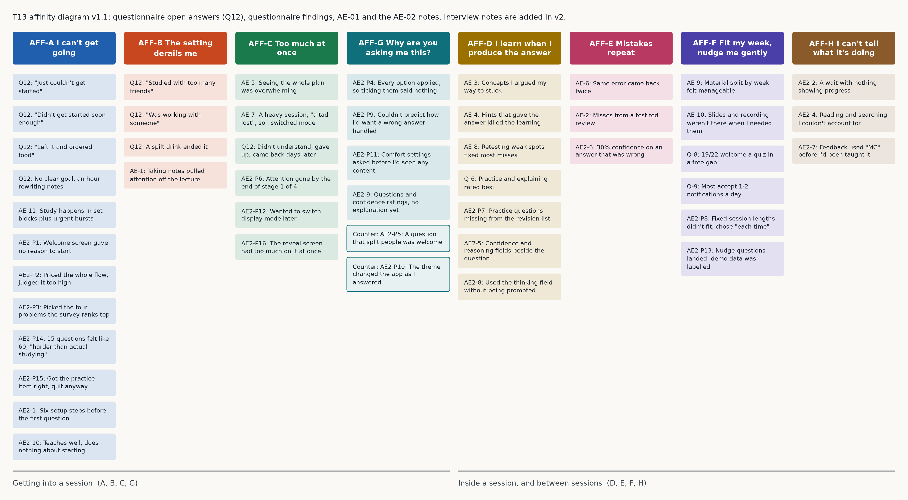

# Affinity diagram (T13)

Status: v1.1, 8 Nov 2026. Sources: questionnaire open answers (Q12, 8 answers), questionnaire findings (`questionnaire-results.md`), the AE-01 log (`autoethnography-01-kobi.md`) and the AE-02 notes (`autoethnography-02-kobi.md`: the onboarding walkthrough `AE2-Pn` and the LearnHarness session `AE2-n`). **v2 adds the interview notes** (`INT-n`) once the interviews are done this week. Every ID below is indexed in `findings-register.md`.

v1 is kept at `figures/affinity-v1.png`. The figure is generated by `figures/make_affinity.py`, so v2 is built by adding the interview notes to that script and running it again.

## Why an affinity diagram
We have three kinds of qualitative data (open answers, autoethnography log entries, questionnaire findings) and no theory telling us how they group. An affinity diagram builds the groups bottom-up from the notes themselves (Wk 7), so the categories come from the data, not from our design idea. We chose it over coding against a fixed framework because a fixed framework would have imported our assumptions.

## How it was built
1. One note per data point, keeping its source ID.
2. Notes grouped by similarity, without naming the groups first.
3. Each group was named in the student's voice ("I can't get going").
4. The groups were sorted into two super-groups: getting into a session, and what happens inside and between sessions.

**v1.1 (8 Nov).** The 27 AE-02 notes were added one at a time to the cluster each one fitted. A new cluster was opened only where at least three notes shared something no existing cluster said. That test opened two: AFF-G and AFF-H. Everything else went into A to F. Two notes were left out of the diagram on purpose, for the reason given below.

## Clusters
| ID | Cluster | Notes | Design implication |
|---|---|---|---|
| **AFF-A** | I can't get going | 3 Q12 "couldn't start" answers; 1 Q12 "no goal for the session"; AE-11; AE2-P1, AE2-P2, AE2-P3, AE2-P14, AE2-P15, AE2-1, AE2-10 | The app's first job is getting a student into a session: one tap, a small defined goal, at a time that fits (Q-1). The setup a student pays before the first useful moment is part of the design, and both tools we walked got it wrong (AE2-P14, AE2-1) |
| **AFF-B** | The setting derails me | 3 Q12 answers about friends, a co-worker or a spilt drink; AE-1 | Sessions are short and resumable, so an interruption doesn't kill them; no social features by default |
| **AFF-C** | Too much at once | AE-5, AE-7; Q12 "didn't understand, gave up"; AE2-P6, AE2-P12, AE2-P16 | Show one step at a time; offer a lighter mode (a worked example) when a student is stuck or overloaded (Q-7). Density spends attention as fast as length does (AE2-P16) |
| **AFF-D** | I learn when I produce the answer | AE-3, AE-4, AE-8; Q-6; AE2-P7, AE2-5, AE2-8 | Sessions are active recall: questions first, hints in steps, never the answer early. Ask for confidence and reasoning next to the answer, which is the cheapest thing in either tool that worked (AE2-5, AE2-8) |
| **AFF-E** | Mistakes repeat | AE-6, AE-2; AE2-6 | Keep an error log and resurface misses in later sessions. A confidence rating catches uncertainty a right-or-wrong record hides (AE2-6) |
| **AFF-F** | Fit my week, nudge me gently | AE-9, AE-10; Q-8, Q-9; AE2-P8, AE2-P13 | Organise content by course week; nudge into free gaps from the timetable; 1-2 nudges a day at most. Don't make the student commit to a session length up front (AE2-P8) |
| **AFF-G** | Why are you asking me this? | AE2-P4, AE2-P9, AE2-P11, AE2-9. Counter-notes: AE2-P5, AE2-P10 | **New in v1.1.** A question that changes something the student can see earns the next one. A question that only collects spends goodwill. Ask few, make each one do something, and infer the rest from behaviour |
| **AFF-H** | I can't tell what it's doing | AE2-2, AE2-4, AE2-7 | **New in v1.1.** Show progress during any wait; say what background work is for; never use a notation or term the session hasn't introduced |

### Why AFF-G and AFF-H were opened
Both cleared the three-note test and neither is said by A to F.

- **AFF-G** is about the cost of being asked. AFF-A covers the cost of starting and AFF-C covers the cost of too much at once. Neither says that a question which collects without giving anything back is itself a cost. AE2-P4, AE2-P9 and AE2-P11 each describe that in a form, and AE2-9 describes it inside a tutor. The two counter-notes are kept in the cluster because they are what makes it a claim: AE2-P5 and AE2-P10 are questions that gave something back and were welcomed by the same participant minutes earlier.
- **AFF-H** is about opacity. AE2-2 is a wait with no progress, AE2-4 is work the participant could not account for, AE2-7 is feedback in a notation never taught. AFF-C would call all three "too much", which is the wrong diagnosis: the problem in each is that the student cannot see what is happening, and the fix is to show it.

### Two notes were not clustered
AE2-3 ("this seems like Claude just with a shell") and AE2-11 ("I don't see it doing anything that Claude couldn't do") are judgements about a product, not observations of how a student studies. Affinity grouping is for the second kind. Putting them on the diagram would have let a build decision dress up as user data. They carry real weight and they belong in the decision brief for the 10 Nov sync (`../meetings/2026-11-10-sync.md`) and in the open contradictions in `findings-register.md`, which is where they are.

## What the diagram changes
- **Three of the eight clusters (A, B, G) are about the moments before and around studying,** and the questionnaire agrees (Q-1, Q-2). Most existing tools start once the student has already started (`existing-solutions.md`). This remains the strongest case for our design's focus, and v1.1 strengthens it: AFF-A has grown from 5 notes to 12, and 7 of the new ones come from walking two real tools.
- **AFF-A now holds evidence from two tools, not just from self-report.** AE2-P15 is the sharpest note on the diagram: a correct answer followed by quitting anyway. Competence was never the barrier there, and accumulated cost was.
- **AFF-C and Q-7 qualify AE theme 2.** Question-led learning works (AFF-D), but a student who is stuck needs a way out that isn't giving up. Both modes stay in the design. AE2-9 adds that sustained questioning without any explanation reads as a test, which is a timing problem for the hi-fi.
- **AFF-G changes what onboarding is for.** On this reading the goal of a first run is not to collect preferences. It is to get the student to a useful moment, and anything learned on the way is a bonus. That is a testable alternative for the lo-fi (T17) and it goes into the QOC at T16.
- **AFF-D gained its first mechanism.** Before v1.1 the cluster said what should happen. AE2-5 and AE2-8 say how: a confidence rating and a reasoning field next to one question, which the participant used unprompted and praised without being asked.

## Limitations
- **The open-answer data is thin:** 8 of 22 answered Q12, and some answers are one line.
- **11 of the notes come from a single autoethnographer (KAYZ),** so clusters D and E lean on one person. The interviews are there to test them.
- **The grouping was done by one person.** v2 should be regrouped with at least one other team member to check the clusters hold.
- **v1.1 makes the single-autoethnographer problem worse.** All 25 new notes come from the same person as the 11 old ones, and they were gathered on one day. 36 of the 47 notes on the diagram are now his, against 11 from the questionnaire. AFF-G and AFF-H rest entirely on that one participant, so both stay hypotheses until the interviews or the lo-fi tests reach them.
- **Two tools were walked in one sitting each,** so the AE-02 notes are first impressions. A second LearnHarness session, where the knowledge graph has something in it, could change AFF-H in particular.
