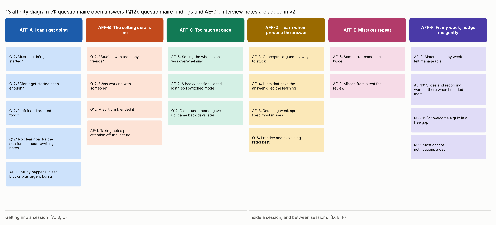

# Affinity diagram (T13)

Status: v1, 8 Nov 2026. Sources: questionnaire open answers (Q12, 8 answers), questionnaire findings (`questionnaire-results.md`) and the AE-01 log (`autoethnography-01-kobi.md`). **v2 adds the interview notes** (`INT-n`) once the interviews are done this week.

## Why an affinity diagram
We have three kinds of qualitative data (open answers, autoethnography log entries, questionnaire findings) and no theory telling us how they group. An affinity diagram builds the groups bottom-up from the notes themselves (Wk 7), so the categories come from the data, not from our design idea. We chose it over coding against a fixed framework because a fixed framework would have imported our assumptions.

## How it was built
1. One note per data point, keeping its source ID.
2. Notes grouped by similarity, without naming the groups first.
3. Each group was named in the student's voice ("I can't get going").
4. The groups were sorted into two super-groups: getting into a session, and what happens inside and between sessions.

## Clusters
| ID | Cluster | Notes | Design implication |
|---|---|---|---|
| **AFF-A** | I can't get going | 3 Q12 "couldn't start" answers; 1 Q12 "no goal for the session"; AE-11 | The app's first job is getting a student into a session: one tap, a small defined goal, at a time that fits (Q-1) |
| **AFF-B** | The setting derails me | 3 Q12 answers about friends, a co-worker or a spilt drink; AE-1 | Sessions are short and resumable, so an interruption doesn't kill them; no social features by default |
| **AFF-C** | Too much at once | AE-5, AE-7; Q12 "didn't understand, gave up" | Show one step at a time; offer a lighter mode (a worked example) when a student is stuck or overloaded (Q-7) |
| **AFF-D** | I learn when I produce the answer | AE-3, AE-4, AE-8; Q-6 | Sessions are active recall: questions first, hints in steps, never the answer early (the LearnHarness engine) |
| **AFF-E** | Mistakes repeat | AE-6, AE-2 | Keep an error log and resurface misses in later sessions |
| **AFF-F** | Fit my week, nudge me gently | AE-9, AE-10; Q-8, Q-9 | Organise content by course week; nudge into free gaps from the timetable; 1-2 nudges a day at most |

## What the diagram changes
- **Two of the six clusters (A, B) are about the moments before and around studying,** and the questionnaire agrees (Q-1, Q-2). Most existing tools start once the student has already started (`existing-solutions.md`). This is the strongest case for our design's focus.
- **AFF-C and Q-7 qualify AE theme 2.** Question-led learning works (AFF-D), but a student who is stuck needs a way out that isn't giving up. Both modes stay in the design.

## Limitations
- **The open-answer data is thin:** 8 of 22 answered Q12, and some answers are one line.
- **11 of the notes come from a single autoethnographer (KAYZ),** so clusters D and E lean on one person. The interviews are there to test them.
- **The grouping was done by one person.** v2 should be regrouped with at least one other team member to check the clusters hold.
