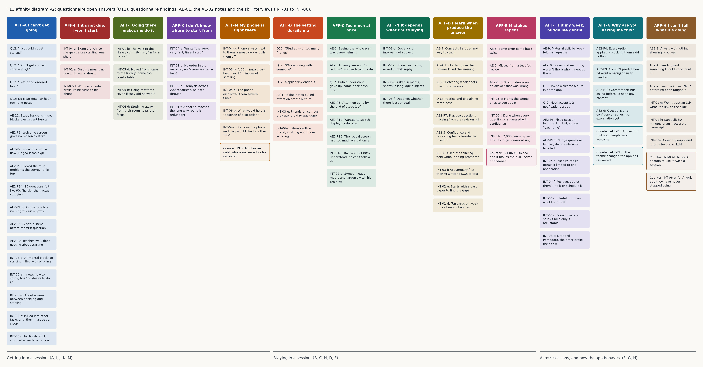

# Affinity diagram (T13)

Status: v2, 14 Nov 2026. Sources: questionnaire open answers (Q12, 8 answers), questionnaire findings (`questionnaire-results.md`), the AE-01 log (`autoethnography-01-kobi.md`), the AE-02 notes (`autoethnography-02-kobi.md`) and **the six interviews** (`interviews/INT-01.md` to `INT-06.md`, counted in `interviews/synthesis.md`). Every ID below is indexed in `findings-register.md`.

v1 and v1.1 are kept at `figures/affinity-v1.png` and `figures/affinity-v1.1.png`. The figure is generated by `figures/make_affinity.py`, so a later version is a data edit and a rerun.

## Why an affinity diagram
We have several kinds of qualitative data (open answers, autoethnography log entries, questionnaire findings, interview findings) and no theory telling us how they group. An affinity diagram builds the groups bottom-up from the notes themselves (Wk 7), so the categories come from the data, not from our design idea. We chose it over coding against a fixed framework because a fixed framework would have imported our assumptions.

## How it was built
1. One note per data point, keeping its source ID.
2. Notes grouped by similarity, without naming the groups first.
3. Each group was named in the student's voice ("I can't get going").
4. The groups were sorted into super-groups.

**v1.1 (8 Nov).** The 27 AE-02 notes were added one at a time. A new cluster opened only where at least three notes shared something no existing cluster said, which opened AFF-G and AFF-H.

**v2 (14 Nov).** The same rule was applied to the 50 interview findings. **44 of the 50 went onto the diagram** and five new clusters opened: AFF-I, AFF-J, AFF-K, AFF-M and AFF-N. The two super-groups became three, because with 13 clusters the old split put the phone, the library and the missing first step in the same bucket as "I can't get going", which hid what each one says.

**One candidate cluster was rejected, and the rejection is the point of having a rule.** A "don't punish me for falling behind" group looked obvious: INT-01-i nearly abandoned a flashcard app after 2,000 cards lapsed, and INT-02-c stops chasing once he sees progress. That is two notes, and the rule needs three. INT-01-i moved into AFF-E, where the error and review system lives. INT-02-c is left off the diagram. Both findings are still live in `findings-register.md` and in change 5 of the synthesis, and the diagram does not pretend they are a pattern yet.

## Clusters
| ID | Cluster | Notes | Design implication |
|---|---|---|---|
| **AFF-A** | I can't get going | 4 Q12 answers; AE-11; AE2-P1, AE2-P2, AE2-P3, AE2-P14, AE2-P15, AE2-1, AE2-10; INT-03-a, INT-05-a, INT-06-a, INT-04-c, INT-05-c | The app's first job is getting a student into a session: one tap, a small defined goal, at a time that fits (Q-1). **17 notes, the largest cluster by a distance.** INT-05-a states it most plainly: a student who knows how to study and has "no desire to do it" |
| **AFF-I** | If it's not due, I won't start | INT-04-a, INT-01-a, INT-02-d | **New in v2.** Urgency does the app's job for it. INT-04-a started immediately with an exam close; INT-01-a works ahead only once behind. **The app's moment is the week with no deadline,** which is the week a student has least reason to open it |
| **AFF-J** | Going there makes me do it | INT-01-b, INT-03-d, INT-05-b, INT-06-d | **New in v2.** Place is the commitment device students already use. INT-05-b went to the library and it mattered "even if they did no work". A digital block competes with a mechanism that works, so it should borrow from it (an announced start, a cost to leaving) |
| **AFF-K** | I don't know where to start from | INT-04-e, INT-01-e, INT-02-b, INT-01-f | **New in v2.** Three degrees, one problem: no entry point. INT-04-e wants "the very, very first, tiniest step", INT-01-e calls unordered material "insurmountable", INT-02-b is paralysed across 200 resources. This is the cheapest high-value thing in the whole diagram |
| **AFF-M** | My phone is right there | INT-04-b, INT-03-b, INT-05-d, INT-06-b, INT-04-d. Counter-note: INT-01-b | **New in v2, and it settles X-6.** Five of six named the phone or social media unprompted. INT-01-b is the counter-case and a design constraint: he leaves notifications uncleared as his cue to study, so a lock would hide it |
| **AFF-B** | The setting derails me | 3 Q12 answers; AE-1; INT-03-e, INT-06-c | Sessions are short and resumable, so an interruption doesn't kill them; no social features by default. Two more sessions lost to friends, both in the place AFF-J recommends |
| **AFF-C** | Too much at once | AE-5, AE-7; Q12 answer; AE2-P6, AE2-P12, AE2-P16; INT-01-c, INT-02-g | Show one step at a time; offer a lighter mode when a student is stuck or overloaded. INT-01-c adds a threshold: below roughly 80% understood, he cannot follow up at all |
| **AFF-N** | It depends what I'm studying | INT-03-g, INT-04-h, INT-06-i, INT-05-f | **New in v2, and it closes X-1.** Q-7 found the population split 10 to 8. All four interviews that were asked said the split runs **inside** each student, by subject, interest or whether there is a set goal. The mode is a per-session choice, never a profile setting |
| **AFF-D** | I learn when I produce the answer | AE-3, AE-4, AE-8; Q-6; AE2-P7, AE2-5, AE2-8; INT-03-f, INT-02-e, INT-01-d | Sessions are active recall: questions first, hints in steps, never the answer early. Ask for confidence and reasoning next to the answer (AE2-5, AE2-8). INT-02-e and INT-01-d both measure first, then target what they got wrong |
| **AFF-E** | Mistakes repeat | AE-6, AE-2; AE2-6; INT-05-e, INT-06-f, INT-01-i. Counter-note: INT-06-e | Keep an error log and resurface misses in later sessions. **INT-01-i sets the limit:** a lapse system that marked 2,000 cards incomplete after 17 days nearly ended the relationship. Recovery has to work "like the gym" |
| **AFF-F** | Fit my week, nudge me gently | AE-9, AE-10; Q-8, Q-9; AE2-P8, AE2-P13; INT-05-g, INT-04-f, INT-06-g, INT-05-h, INT-03-c | Organise by course week; nudge into free gaps; **one notification, never repeated** (INT-05-g: repeats "get on my nerves"). Blocks adjustable week by week (INT-05-h), and no fixed timer cycle (INT-03-c dropped Pomodoro because it broke their flow) |
| **AFF-G** | Why are you asking me this? | AE2-P4, AE2-P9, AE2-P11, AE2-9. Counter-notes: AE2-P5, AE2-P10 | A question that changes something the student can see earns the next one. A question that only collects spends goodwill. Ask few, make each one do something, infer the rest from behaviour |
| **AFF-H** | I can't tell what it's doing | AE2-2, AE2-4, AE2-7; INT-01-g, INT-01-h, INT-02-i. Counter-notes: INT-03-f, INT-06-e | Show progress during a wait; say what background work is for; never use a notation the session hasn't introduced. **INT-01-g extends it to the AI itself:** every explanation links back to the exact slide, so a student who distrusts LLMs can check it |

### Why the five new clusters opened
Each cleared the three-note rule and says something no existing cluster said.

- **AFF-I** is about *when*, and AFF-A is about *whether*. AFF-A says students struggle to start. AFF-I says the struggle appears only when nothing is due, which changes when the app should act.
- **AFF-J** is the positive inverse of AFF-B. AFF-B says the setting derails you. AFF-J says a setting can commit you, and four participants use it deliberately.
- **AFF-K** is about the artefact, where AFF-A is about the moment. A student can want to start and still have nowhere to put their hands.
- **AFF-M** is a distinct mechanism. AFF-B's notes are friends, a co-worker and a spilt drink. The phone is always present, needs no one else, and now has five notes of its own.
- **AFF-N** is about variability within a person. AFF-D says students learn by producing the answer; AFF-N says how they want to be taken there changes with the material.

### Six interview findings were not clustered
**INT-04-g** and **INT-06-h** are reactions to the phone lock we proposed, and **INT-02-c** is a single statement that visible progress is a cue to stop. **INT-02-a**, **INT-02-f** and **INT-02-h** describe one participant's self-directed study context and match nothing else in the set. They stay out for the same reason AE2-3 and AE2-11 stayed out of v1.1: evaluations of our own design and unrepeated singletons are not observations of how students study, and clustering them would let a design opinion dress up as user data. All six are live in `findings-register.md`, and INT-04-g and INT-06-h are the whole of **X-8**, the most important open question the project has.

## What the diagram changes
- **Five of the thirteen clusters (A, I, J, K, M) are now about the moments before studying,** and they hold 34 of the 94 notes. v1.1 had three such clusters. The case for leading on the start moment has stopped being an interpretation and become the shape of the data.
- **AFF-A is 17 notes and the next largest is 11.** No reading of this diagram puts the teaching engine at the centre of the product.
- **AFF-K is the new actionable finding.** Three participants from three different degrees described having no entry point, in their own words and unprompted. It is also the cheapest thing on the diagram to build: a first screen that names one small step.
- **AFF-M settles X-6 and AFF-N closes X-1.** The phone question and the shown-versus-asked question were both open after the questionnaire. The interviews answered them.
- **AFF-F has gained the conditions that make a nudge acceptable.** One notification (INT-05-g), timed or schedulable (INT-04-f), with blocks the student can move (INT-05-h) and no fixed cycle (INT-03-c).
- **What the diagram does not show is the objection.** INT-04-g and INT-06-h refuse the lock, and they are deliberately off the diagram. A reader who looks only at this figure would miss the strongest counter-argument the project has. Read it with X-8.

## Limitations
- **The open-answer data is thin:** 8 of 22 answered Q12, and some answers are one line.
- **The grouping was done by one person.** v1.1 said another team member should regroup it. That has still not happened, and it matters more now there are 94 notes and 13 clusters.
- **The single-autoethnographer problem is much weaker, and here is the number.** In v1.1, 36 of 47 notes came from KAYZ (AE-n and AE2-n), which was 77%. In v2, **36 of 94, which is 38%.** The interviews supply 47 note-slots from 44 distinct findings across six participants, and the questionnaire 11. The diagram no longer rests on one person, and AFF-I, AFF-J, AFF-K, AFF-M and AFF-N contain **no** autoethnography notes at all.
- **The interview evidence is not uniform.** INT-01 and INT-02 are the interviewer's own notes with no recording; INT-03 to INT-06 are AI summaries not yet checked against the transcripts. Notes on this diagram inherit that.
- **Three findings sit in two clusters each** (INT-01-b, INT-03-f, INT-06-e), in each case as a note in one and a counter-note in another. That is deliberate, and it means the note count is slightly higher than the finding count.
- **n is still 6 for the interviews and 22 for the questionnaire,** and all participants were recruited through the group's own networks.
