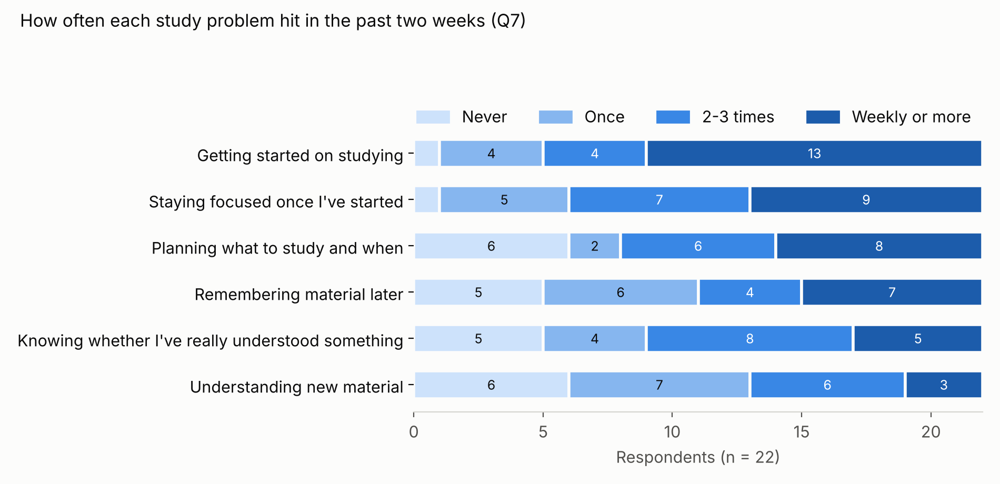
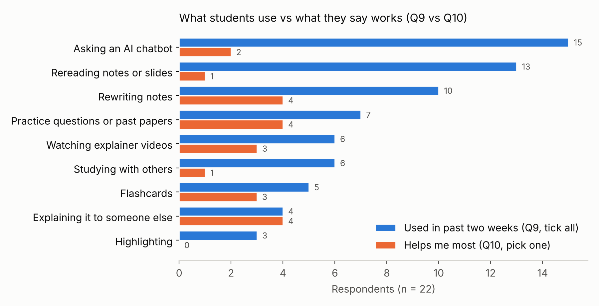

# Questionnaire v2: results (T12)

Status: v1 of the analysis, 8 Nov 2026. Form: "How students study (HCI research, anonymous)", live 31 Oct to 8 Nov. **n = 22.** Raw responses stay in KAYZ's Google account and are **not** committed here, because Q16 collected email addresses (see Ethics below).

Every finding has an ID (`Q-n`). Requirements, personas and hi-fi features cite these IDs (see the traceability rule in `../PLAN.md`).

## Who answered
| | |
|---|---|
| Year | 3rd year+ UG 10, 2nd year 5, postgraduate 5, 1st year 2 |
| Subject | STEM 9, business or law 4, social sciences 4, arts and humanities 3, health 1, other 1 |
| Neurodivergent (Q3) | Yes 4, not sure 8, no 10 |
| Lectures attended in person, past two weeks (Q4) | All 2, most 6, about half 3, a few 4, none 7 |

## Findings

| ID | Finding | Evidence | Tests AE theme |
|---|---|---|---|
| **Q-1** | **Getting started is the most frequent study problem and the top priority.** | Q7: 13/22 (59%) hit it weekly or more. Q8: 7/22 would pick it if an app could fix one thing, the most of any option. | 3 (load), 5 (structure) |
| **Q-2** | **Staying focused is a close second.** | Q7: 9/22 weekly or more, 21/22 at least once. Q8: 6/22 pick it. Together with Q-1, **13/22 priority picks are about starting or sustaining a session**, before any content is involved. | 3 |
| **Q-3** | **Understanding new material is the least frequent problem.** | Q7: only 3/22 weekly or more; 13/22 once or never. Q8: 1/22 pick it. | Challenges a pure "AI tutor explains content" design |
| **Q-4** | **Attention in lectures drifts early.** | Q6: 11 of the 19 who answered with a time drifted within 20 minutes; 5 within 10 minutes. Only 1 said it didn't drift. | 1 (capture vs attention), partly supported |
| **Q-5** | **Recordings are not the main study channel.** | Q5: 11/22 don't watch recordings. Of those who do, 6 speed them up and 5 skip to the parts they need. Q4: 7/22 attended no lectures in person in the past two weeks. | 1, weakens LectureFlow's recording-first assumption |
| **Q-6** | **What students do most isn't what they rate.** | Q9 vs Q10: AI chatbots are used by 15/22 but rated most helpful by 2. Rereading: used by 13, rated best by 1. Practice questions (7 use, 4 rate best) and explaining to someone (4 use, 4 rate best) convert far better. Generative methods (practice, explaining, flashcards) are rated best by 11/22 against 8/22 for passive ones (rereading, rewriting, videos). | 2 (generating answers sticks), supported |
| **Q-7** | **There's no single preferred teaching mode.** | Q11 (1 = show me, 5 = question me): mean 3.05; 10 lean to being questioned (4-5), 8 to being shown (1-2), 4 neutral. | 2, only partly supported: questioning can't be forced as the only mode |
| **Q-8** | **Proactive nudges are welcome.** | Q13 (quiz suggested in a free gap, unprompted): 19/22 welcome or very welcome (mean 4.3/5); 1 unwelcome. | 5, strongly supported; meets the brief's proactive requirement |
| **Q-9** | **The notification budget is 1-2 a day.** | Q15: 15/22 would switch off beyond 1-2 a day; 4 accept 3-5; 3 accept 6+; nobody chose "none". | 5 |
| **Q-10** | **Timetable and lecture materials are acceptable data sources; location isn't.** | Q14: timetable 21/22, slides and recordings 19/22, screen time 14/22, location 3/22. | Brief: external data or sensors |
| **Q-11** | **Bad sessions fail at the start or in the social setting, rarely on content.** | Q12, 8 open answers. Failure to start or abandoning (3: "just couldn't get started", "didn't get started soon enough", "left it and ordered food"); social context derailed it (3: studying with too many friends, working with someone, a spilt drink); no goal for the session (1); a comprehension wall and then avoidance (1). | 3, 5 |
| **Q-12** | **The neurodivergent split shows no clear difference at this sample size.** | Yes or not sure (12) vs no (10). Getting started weekly or more: 67% vs 50%. Focus: 42% vs 40%. Q11 mean 2.92 vs 3.2. Q13 mean 4.2 vs 4.4. | RQ6: design for all students, adapt per person; don't build a separate ND mode on this evidence |

## What this means for the design (candidate requirements, to be confirmed by T13 and T15)
1. **Lead on starting and sustaining a session** (Q-1, Q-2, Q-11), ahead of explaining content (Q-3). The first screen should get a student into a session in seconds, with a small, defined goal.
2. **Use active recall: practice questions and self-explanation** (Q-6), with **both modes available**: guided questioning, or a worked example first (Q-7). The mode is a user setting, possibly learned from behaviour.
3. **Be proactive, but rationed:** nudge into free gaps from the timetable (Q-8, Q-10), at most 1-2 notifications a day by default (Q-9).
4. **Sense timetable and lecture materials; never location** (Q-10).
5. **Keep sessions short.** Attention drifts inside 20 minutes for most (Q-4), so default sessions should be shorter than that.

## Alternative interpretations (rubric criteria 3 and 4)
- **Q-3 could be social desirability.** Students may underreport not understanding. The interviews should probe it.
- **Q-6:** "used by 15, rated best by 2" may mean AI is a convenience tool, not a bad one. Students may also rate the method they feel is "proper" studying.
- **Q-7:** a split preference may reflect the subject (STEM vs humanities) more than the person. n is too small to test that.

## Limitations
- **n = 22, a convenience sample** from KAYZ's network, weighted towards 3rd year+ and STEM. Results are indicative, not generalisable.
- **Self-report over a two-week recall window.** That's why the questions asked about concrete, recent behaviour, but recall bias remains.
- **Neurodivergence was self-identified,** and 8/22 chose "not sure", so the ND comparison (Q-12) is weak.
- **Q10 offered all methods, not only the ones each person ticked in Q9,** so some "helps most" answers are methods the respondent didn't use.
- **Q11 and Q13 are single items,** so there's no internal reliability check.

## Ethics
The intro promised anonymity, but Q16 was changed to collect emails inside the same form. To honour the promise: the raw export isn't committed, the emails are used only to invite interview volunteers, and interview notes are kept separate from questionnaire answers.

## Next
- T13 affinity diagram: Q12 answers, AE-01 log and interview notes.
- Interviews (this week) probe Q-1, Q-3 and Q-7.
